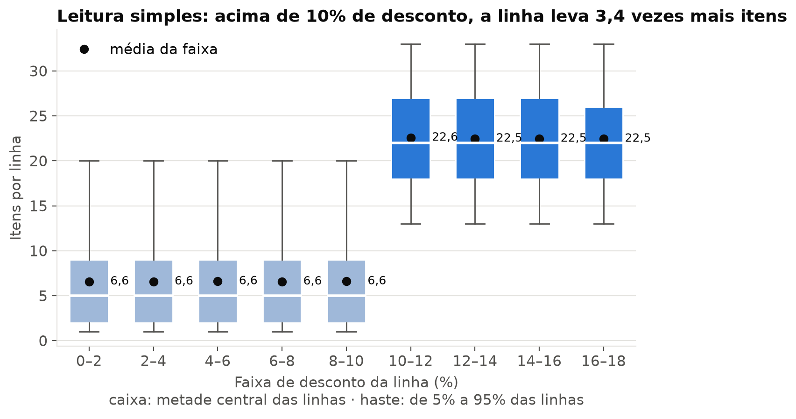
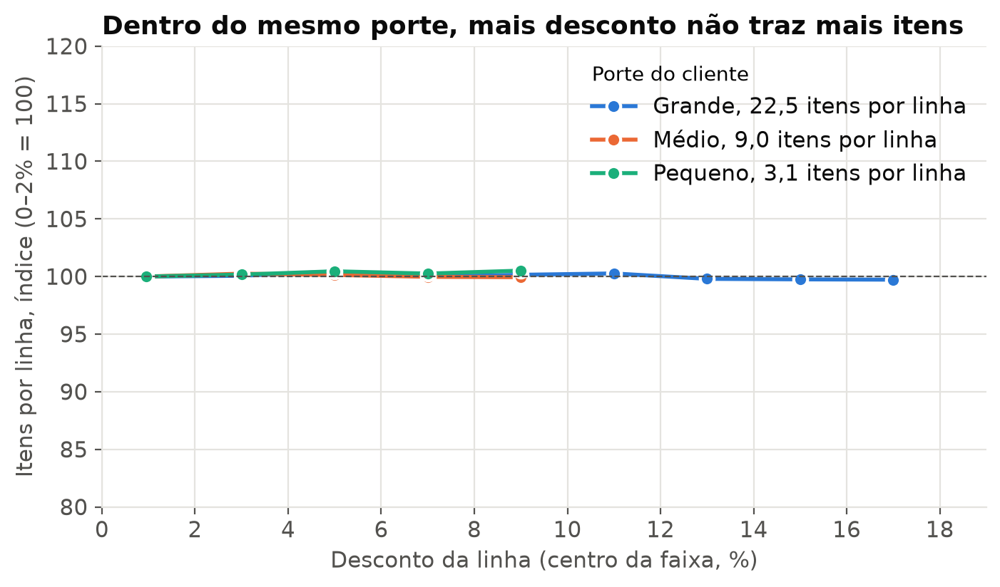

# Análise e relatório

**O desconto ao cliente grande não comprava volume, e um teto de 10% teria recuperado R$ 5,5
milhões de margem no último ano.**

Uma distribuidora concede até 18% de desconto ao cliente grande e até 10% aos demais, com o
argumento de que o desconto traz volume. A análise responde se esse volume existe e quanto vale
mudar a regra, com o critério de decisão escrito antes de olhar o resultado, e entrega a resposta
junto com o ponto que a faria mudar, que é justamente o risco que o dado não consegue medir.

| A leitura simples | A análise |
|---|---|
|  |  |

## Resultado

Demonstração com 1 milhão de linhas de pedido, 20 mil clientes e 36 meses de vendas.

| O que a leitura simples dizia | O que o dado sustenta | Decisão | Ganho do teto em 12 meses |
|---|---|---|---|
| **3,4 vezes mais itens** nas linhas com mais de 10% de desconto | **nenhum efeito mensurável** dentro do mesmo porte, quando o desconto só se pagaria com +3,2% de volume por ponto | **teto de 10%** pelo critério definido antes | **R$ 5,5 milhões** de margem, se nenhum cliente sair |

A diferença que a leitura simples mostrava vinha toda do porte, porque só o cliente grande recebe
mais de 10% de desconto, e ele compra mais por ser grande. O ganho desaparece se clientes
grandes que somam 4,8% da margem do porte deixarem de comprar, ou se todos eles passarem a comprar
4,8% menos, e a base não registra a venda perdida. Por isso o relatório recomenda um piloto de 12
meses em metade dos clientes grandes, sorteada dentro de cada vendedor, com tamanho calculado para
mostrar se a saída de clientes fica abaixo do ponto que anularia o ganho. Depois da adoção, um grupo
de controle mantido na política atual acompanha a queda pequena e uniforme de compra, que só
aparece com o tempo.

## O que você recebe

- **Relatório em PDF**, com situação, método, resultado, conclusão e limitações, escrito para
  quem decide.
- **Notebook que roda do zero**, com cada número do relatório apontando para a célula que o gera.
- **Critério de decisão registrado antes da análise**, para o resultado não ser escolhido depois.
- **Resposta com o ponto de virada**, que mostra o que precisaria acontecer para a decisão mudar.
- **Desenho do próximo passo**, quando o dado sozinho não fecha a pergunta.

## Como funciona

1. **Enquadramento.** Transforma a dúvida da área numa pergunta com decisão, linha de base e
   critério, escritos antes de abrir o dado.
2. **Análise.** Perfila a base, separa o que confunde a leitura e mede o efeito com intervalo.
3. **Relatório.** Entrega a resposta, o ponto de virada, a limitação e o passo seguinte, em
   linguagem de negócio.

## Contato

Para responder uma pergunta assim com os dados da sua empresa, fale comigo pelo
[LinkedIn](https://www.linkedin.com/in/mbelmontee).

## Para aprofundar

| Documento | O que traz |
|---|---|
| [Relatório](relatorio.md) | a resposta completa, com limitações e anexos (em PDF: `relatorio.pdf`) |
| [Guia técnico](evidencias/README.md) | método, rastreabilidade e como refazer tudo numa máquina limpa |
| [Notebook](analise.ipynb) | a análise de ponta a ponta |
| [Enquadramento](evidencias/enquadramento.md) | pergunta, linhas de base e critério, escritos antes do resultado |
| [Perfilamento](evidencias/perfilamento.md) | o estado da base antes da análise |

Custo da demonstração: zero, porque o gerador, o Python e as bibliotecas são gratuitos e nada fica
hospedado. A base é 100% fictícia, gerada pelo
[`port-gerador-dados`](https://github.com/Bellmonte/port-gerador-dados), sem vínculo com
organização ou pessoa real. Ela foi gerada sem ligação entre desconto e volume, e o caso mostra o
método encontrando essa resposta conhecida.

---

**B&B** · Matheus Belmonte
