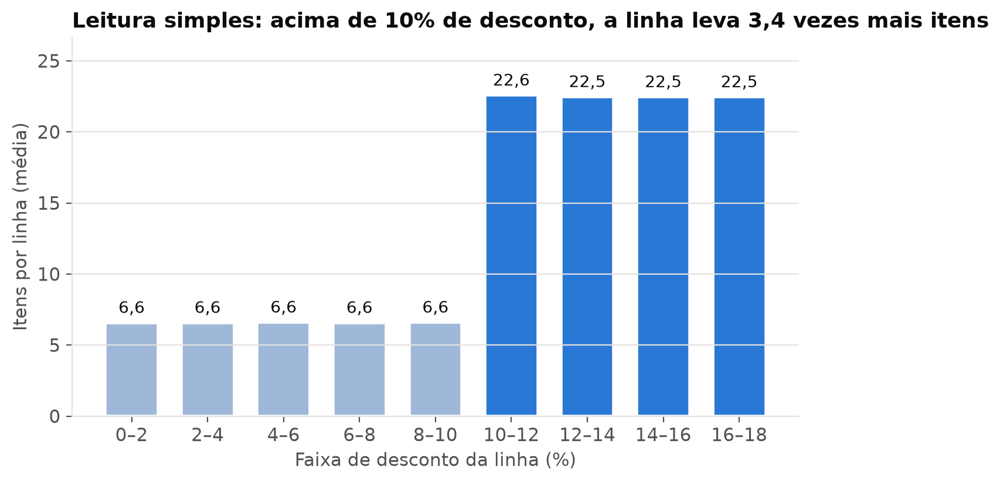
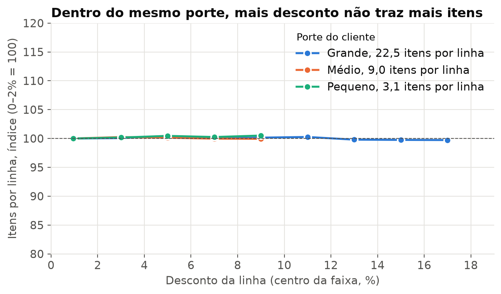
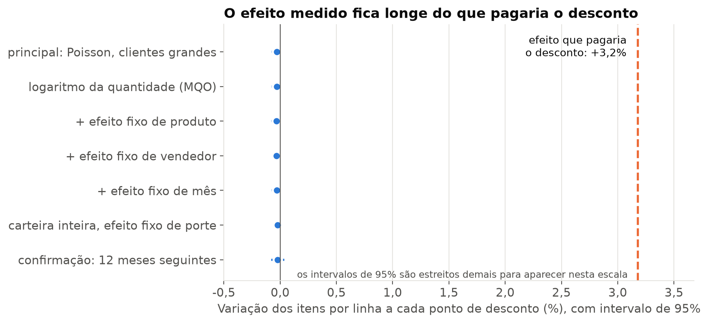
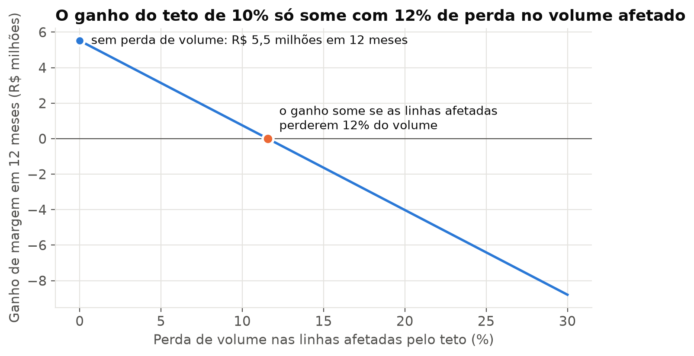

# Desconto e volume na carteira de clientes grandes

## Relatório de análise da política comercial

Este relatório responde a uma pergunta de política comercial sobre a base de vendas de uma
distribuidora fictícia: o desconto concedido ao cliente está trazendo volume que pague o que custa,
e quanto a empresa recupera limitando o desconto do cliente grande a 10%. A análise segue as seis
fases do CRISP-DM, do entendimento do negócio à avaliação, e o relatório se organiza em situação,
ação e resultado. O trabalho é um entregável de **etapa 1**, que roda na máquina de quem contrata
e não deixa nada hospedado.

> **Dados 100% fictícios.** A base foi gerada por sorteio pelo `port-gerador-dados`, sem vínculo
> com organização ou pessoa real. Os números ilustram o método e não descrevem nenhuma empresa.

Cada número do texto aponta, entre colchetes, para a célula do notebook `analise.ipynb` que o
calcula. A base tem 1.000.000 de linhas de pedido, 249.858 pedidos e 20.000 clientes em 36 meses,
de setembro de 2023 a agosto de 2026 [C07].

## Resumo para decisão

O desconto não está comprando volume. Na leitura simples, as linhas com mais de 10% de desconto
levam 3,4 vezes mais itens que as demais, mas essa diferença vem inteira do porte do cliente,
porque só o cliente grande recebe desconto acima de 10%. Dentro do mesmo porte, cada ponto de
desconto muda a quantidade em -0,031%, com intervalo de 95% entre -0,066% e 0,004%, quando o mínimo
que pagaria o desconto seria +3,2% por ponto [C17, C20, C23].

Pelo critério definido antes da análise, a decisão é **recomendar o teto de 10% para o cliente
grande**. Nos últimos 12 meses ele teria rendido R$ 5,5 milhões de margem, numa faixa de
R$ 5,4 milhões a R$ 5,7 milhões, o equivalente a 5,0% da margem desses clientes [C27, C30, C31].
O ganho só desaparece se os clientes grandes que somam 4,8% da margem do porte deixarem de comprar,
ou se todos eles passarem a comprar 4,8% menos, e a base não tem como medir esse risco, porque não
registra a venda que deixou de acontecer [C30]. Por isso a recomendação é aplicar o teto primeiro
num piloto de 12 meses com metade dos clientes grandes, desenhado para detectar a saída de clientes
nos primeiros seis meses antes de ela chegar a esse ponto. A queda pequena e uniforme de volume fica
fora do alcance do piloto, porque com esse número de clientes ele só enxerga uma queda de 6% [C35].

## 1. Situação

A política em vigor deixa o vendedor conceder desconto por linha de pedido até um teto que depende
do porte do cliente: 18% para o cliente grande e 10% para os demais. Em três anos, o desconto
somou R$ 148,4 milhões, o equivalente a 17% da margem do período [C14]. O cliente grande responde
por 13% das linhas e por 53% de todo o desconto, e o que ele recebe equivale a 25% da margem que
gera [C14]. Nos últimos 12 meses foram R$ 27,8 milhões de desconto ao cliente grande, sobre uma
margem de R$ 110,5 milhões [C16].

A política se apoia num argumento comum em qualquer área comercial, o de que o desconto compra
volume e por isso se paga. Quando o volume não vem, o desconto vira margem entregue sem
contrapartida, e é no teto mais alto do cliente grande que essa conta pesa mais.

O perfilamento da base não encontrou nulo, chave duplicada, valor fora do domínio nem linha com
margem negativa, e a leitura confere com as somas de controle do gerador. O resumo está no anexo B.

## 2. Ação

**Pergunta, linha de base e critério foram escritos antes do resultado**, num documento datado e com
o hash registrado, para que o critério não pudesse ser ajustado ao número. A pergunta é se o
desconto acima de 10% se paga em volume entre clientes grandes. Duas linhas de base servem de
comparação: a política atual, que é a regra que existe hoje, e a leitura simples, que compara a
quantidade média por faixa de desconto sem separar o porte e é o que um relatório comum mostraria.

**O método mede o efeito dentro do mesmo porte.** O porte é a variável que confunde a leitura
simples: o cliente grande compra mais por ser grande e também é o único que pode receber desconto
acima de 10%, então as duas coisas andam juntas sem que uma cause a outra. O efeito do desconto foi
estimado só entre clientes grandes, por regressão de Poisson da quantidade sobre o desconto, com o
erro agrupado por cliente e por vendedor. Quatro variações conferem a robustez: a regressão do
logaritmo da quantidade e os controles de produto, de vendedor e de mês.

**O ponto de equilíbrio sai da própria conta do teto.** Tirar desconto aumenta a margem de cada
linha, e só uma perda de volume pode anular esse ganho. O ponto de equilíbrio é o efeito do desconto
sobre a quantidade que zeraria o ganho do teto de 10%, e ele vale +3,2% de quantidade por ponto de
desconto [C20].

**O critério de decisão compara o intervalo do efeito com esse equilíbrio.** Intervalo inteiro
abaixo do equilíbrio recomenda o teto, intervalo inteiro acima mantém a política, e intervalo que
contém o equilíbrio deixa a decisão inconclusiva, com um teste controlado como passo seguinte. A
estimativa usa os primeiros 24 meses e é confirmada nos 12 meses seguintes. A confirmação e as
variações de robustez só podem rebaixar a decisão para inconclusiva, nunca promovê-la.

## 3. Resultado

**A leitura simples engana.** As linhas com até 10% de desconto levam 6,6 itens em média, e as
acima de 10% levam 22,5, ou 3,4 vezes mais [C17]. Uma regressão que ignora o porte diria que cada
ponto de desconto traz 7,7% mais itens [C24].

**Dentro do mesmo porte, o desconto não move a quantidade.** O cliente pequeno leva 3,1 itens por
linha, o médio 9,0 e o grande 22,5, qualquer que seja o desconto, e nos 36 meses nenhuma faixa
se afasta mais de 0,7% da primeira faixa do próprio porte, a de 0 a 2% [C21]. Separando o porte, o efeito na carteira
inteira cai de 7,7% para -0,021% por ponto [C24].

**O efeito medido fica longe do que pagaria o desconto.** Entre clientes grandes, o efeito
principal é de -0,031% por ponto, com intervalo de 95% entre -0,066% e 0,004%, estimado sobre
82.955 linhas [C23]. Na mesma janela, o maior limite superior entre as especificações do cliente
grande é 0,007%, e o equilíbrio de +3,2% fica a 176 erros padrão da estimativa principal
[C20, C23, C27]. Nos 12 meses seguintes o intervalo fica entre -0,070% e 0,027%, para um
equilíbrio também de 3,2% [C26]. Todas as especificações levam à mesma decisão, que é
**recomendar o teto** [C27].

**O teto de 10% teria rendido R$ 5,5 milhões em 12 meses.** O valor supõe que nenhum cliente
compre menos. A faixa de R$ 5,4 milhões a R$ 5,7 milhões combina dois cenários com reamostragem de
clientes, um sem perda de volume e outro com o pior efeito plausível do desconto, e vai do limite
inferior do cenário pessimista ao limite superior do otimista [C31]. O teto atinge 44% das linhas
do cliente grande e equivale a 5,0% da margem desses clientes, ou 1,8% da margem da empresa [C30].

O ponto frágil da conta está fora da base. O ganho desaparece se as linhas afetadas perderem 12%
do volume, se clientes grandes que somam 4,8% da margem desse porte deixarem de comprar, ou se
todos os clientes grandes passarem a comprar 4,8% menos [C30]. A base não tem como medir nenhum
desses cenários, e a conta completa está no anexo A.

**A exposição é pulverizada.** Dos 2.531 clientes grandes ativos no ano, 2.470 (98%) teriam alguma
linha limitada, e 600 deles (24% dos afetados) concentram metade do ganho [C32]. A média é
R$ 2,2 mil de margem por conta no ano, e a conta mais exposta soma R$ 10,7 mil [C32]. Nenhuma
negociação isolada decide o resultado, o que favorece um teto geral em vez de regra por conta.

**Tetos intermediários rendem menos e toleram menos perda.** A mesma conta para o teto de 12% dá
R$ 3,1 milhões, e para o de 14%, R$ 1,4 milhão [C33].

| Teto do cliente grande | Linhas afetadas | Ganho em 12 meses, sem perda | Perda de volume nas linhas afetadas que zera o ganho |
|---|---|---|---|
| 10% | 44% | R$ 5,5 milhões | 12% |
| 12% | 33% | R$ 3,1 milhões | 9% |
| 14% | 22% | R$ 1,4 milhão | 7% |

## 4. Conclusão e recomendação

Na base analisada, o desconto acima de 10% concedido ao cliente grande não traz volume que o pague,
e a política atual entrega margem sem contrapartida mensurável. O critério escrito antes da análise
leva à recomendação do teto de 10%, que teria rendido entre R$ 5,4 milhões e R$ 5,7 milhões de
margem nos últimos 12 meses [C31].

A entrada do teto deve ser gradual, porque o dado histórico mostra que o desconto não aumenta o
pedido de quem compra, mas não mostra o cliente que deixaria de comprar sem ele. O caminho
recomendado é um piloto em que metade dos clientes grandes do cadastro, sorteada, recebe o teto de
10% por 12 meses, enquanto a outra metade segue na política atual. O desenho é de não
inferioridade, e o teto passa a valer para todos se o piloto demonstrar que a saída de clientes
fica abaixo da que zeraria o ganho, a de clientes que somam 4,8% da margem do porte, supondo que
quem sai tem a margem média [C30, C35].

A saída é lida pela parcela de clientes grandes sem compra no segundo semestre do piloto, que hoje
é de 12%. Quem deixar de comprar nos primeiros seis meses aparece inteiro nessa parcela, e a saída
que zeraria o ganho a faria subir 4,2 pontos percentuais. Com 1.284 clientes em cada grupo, o
piloto detecta uma alta de 3,2 pontos, e por isso enxerga essa saída antes de ela anular o ganho
[C35]. A saída que só começar no segundo semestre aparece diluída na métrica, e esse é o limite do
desenho.

O volume por cliente acompanha o piloto como segunda métrica, com uma limitação declarada. A menor
queda detectável nele, em 12 meses, é de 6%, acima dos 4,8% que zerariam o ganho, e por isso uma
redução pequena e uniforme de compra em todos os clientes passaria despercebida [C35]. Para cobrir
esse risco depois da adoção, a recomendação é manter uma parte dos clientes grandes, sorteada, na
política atual por mais tempo, como grupo de controle permanente, e comparar o volume por cliente
dos dois grupos, com tamanho e duração definidos por um dimensionamento próprio, porque um grupo
menor que o do piloto precisa de mais tempo para enxergar a mesma queda. Comparar só o antes e o depois, ou olhar a margem, não serve, porque a margem sobe
com o próprio teto e o mercado muda no meio do caminho.

## 5. Limitações

A natureza da base limita o que esta análise permite afirmar, e os limites são estes.

- **A base foi gerada sem resposta do volume ao desconto.** O gerador sorteia o desconto de cada
  linha sem ligação com a quantidade, e isso foi declarado antes da análise. O resultado recupera
  essa regra, o que demonstra que o método separa a leitura simples do efeito real, mas não mede o
  comportamento de cliente nenhum.
- **A venda perdida não deixa linha.** O cliente que deixou de comprar por causa do preço é
  invisível a esta análise, e a faixa do ganho não inclui esse risco, que só o piloto consegue
  medir.
- **Em dado real o desconto é negociado.** Numa operação real o desconto costuma vir porque o
  pedido já é grande ou porque o cliente ameaçou sair, e a regressão sobre o histórico não separa
  uma coisa da outra, o que deixa a decisão dependente do teste controlado.
- **A frequência de compra também foi sorteada.** A leitura exploratória de recompra não encontrou
  relação entre o desconto recebido e os pedidos seguintes (anexo A), mas na base o cliente de
  cada pedido é sorteado sem histórico, então essa ausência também vem da geração.
- **A estabilidade no tempo é da base.** A confirmação nos 12 meses seguintes deu a mesma resposta
  porque o gerador não muda de comportamento. Em dado real, mudança de mercado, de concorrência ou
  de política no meio da janela pode quebrar essa estabilidade.
- **Ficam fora do alcance da base** a reação da concorrência, o efeito sobre os outros produtos do
  cliente e a compensação que o vendedor poderia oferecer por prazo ou bonificação.

<!-- quebra -->

## Anexo A. Robustez e leituras complementares

**Efeito do desconto por especificação**, em variação da quantidade a cada ponto de desconto, com
intervalo de 95%, entre clientes grandes [C23, C24, C26]:

| Especificação | Janela | Efeito | Intervalo de 95% |
|---|---|---|---|
| Poisson, principal | 24 meses | -0,031% | -0,066% a 0,004% |
| Poisson, carteira inteira com efeito de porte | 24 meses | -0,021% | -0,049% a 0,006% |
| Poisson, confirmação | 12 meses seguintes | -0,022% | -0,070% a 0,027% |
| maior limite superior entre as especificações do cliente grande | 24 meses | | até 0,007% |

As variações com logaritmo da quantidade e com controle de produto, de vendedor e de mês estão no
notebook, todas com efeito negativo e próximo de zero, e todas com o intervalo abaixo do
equilíbrio [C23].

**Recompra, leitura exploratória sem voto na decisão.** Entre 2.567 clientes grandes, cada ponto a
mais de desconto médio recebido nos primeiros 24 meses se associa a uma variação de 0,2% nos
pedidos dos 12 meses seguintes, com intervalo de -1,2% a 1,6%, para uma média de 4,4 pedidos por
cliente [C29]. Não há sinal de que o desconto traga o cliente de volta.

**Robustez do ganho.** O ganho sem perda de volume é de R$ 5,5 milhões [C30]. O pior efeito
plausível do desconto, aplicado às linhas afetadas, quase não muda esse valor, porque o limite
superior do efeito é praticamente zero. A incerteza relevante é a perda de volume que a base não
registra: o ganho zera com 12% de perda nas linhas afetadas, com a saída de clientes grandes que
somam 4,8% da margem do porte, ou com uma queda uniforme de 4,8% no volume de todos eles [C30].

## Anexo B. Perfilamento da base

| Item | Resultado |
|---|---|
| grão | uma linha por produto dentro de um pedido; o pedido não repete produto |
| volume | 1.000.000 linhas, 249.858 pedidos, 20.000 clientes, 36 meses [C07] |
| nulos e chaves | nenhum nulo; chave de linha e par pedido e produto únicos [C07, C08] |
| domínio | desconto entre 0 e 18%, e até 10% fora do porte grande; quantidade de pelo menos 1; nenhuma margem negativa [C12] |
| coerência | receita líquida igual à bruta menos o desconto, e margem igual à líquida menos o custo, com tolerância de um centavo [C12] |
| extremos | 1,4% das linhas acima da cerca do intervalo interquartil do próprio porte, mantidas como pedido grande legítimo [C13] |
| média ponderada | o desconto sobre a receita coincide com a média simples por linha, porque o desconto não depende do tamanho da linha [C14] |

O detalhe está em `evidencias/perfilamento.md`.

## Anexo C. Como reproduzir

O guia técnico em `evidencias/README.md` traz o passo a passo numa máquina limpa: gerar a base com
o comando de data fixa, instalar as dependências do `requirements.txt` e executar o notebook. A
execução completa leva menos de um minuto. O custo é zero, porque o gerador, o Python e as
bibliotecas são gratuitos e nada fica hospedado.

Roteiros de método aplicados: enquadramento com CRISP-DM, perfilamento de base nova, detecção de
extremos, preparação de base, análise de correlação, regressão para explicação, cálculo de retorno
com faixa, e planejamento de teste controlado com dimensionamento de amostra.
