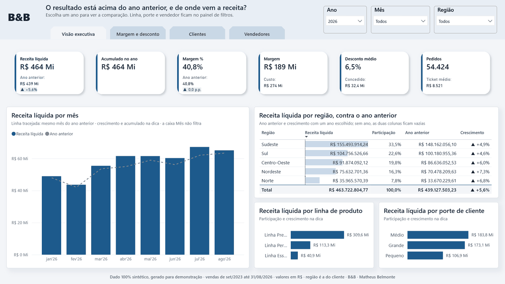
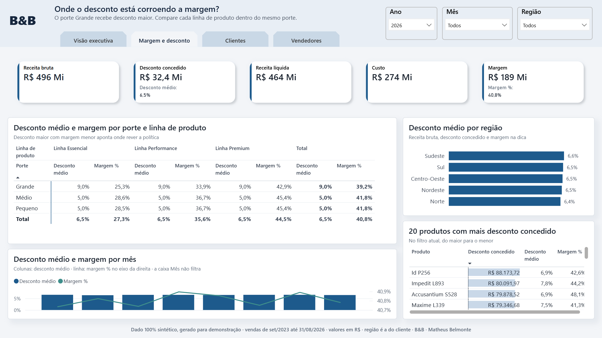
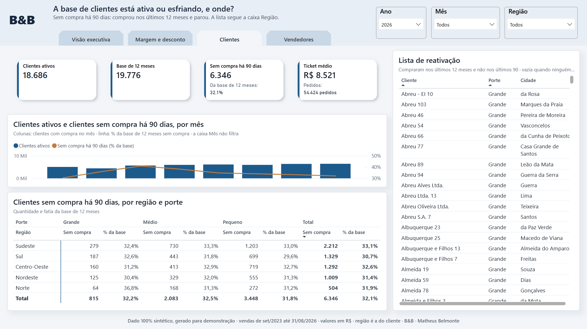
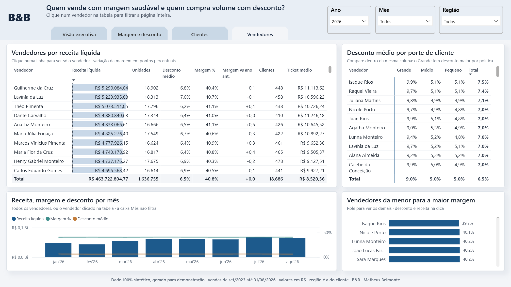

# Construção de painéis Power BI

**Do levantamento ao painel: 20 indicadores com regra escrita e zero divergência em 167.620
comparações com a base.**

Um painel novo costuma nascer de uma lista de gráficos, e os problemas aparecem depois, quando duas
áreas chegam à reunião com números diferentes para o mesmo indicador. A construção começa pelas
decisões que o painel precisa apoiar, escreve a regra de cada indicador antes de qualquer visual e só
entrega quando cada número foi conferido contra a conta feita direto na base.

## Resultado

Demonstração: painel comercial pensado para a diretoria comercial, sobre 1 milhão de linhas de venda
de 01-09-2023 a 31-08-2026.

| Decisões apoiadas | Indicadores | Páginas | Números de negócio |
|---|---|---|---|
| **4** resultado, desconto, clientes e vendedores | **20** com regra escrita e dicionário | **4** uma por decisão | **0 divergências** em 167.620 comparações com a base |

## O que você recebe

- **Levantamento de indicadores**, em Word, com as decisões que o painel apoia, a regra de cada
  indicador e os critérios de aceite combinados antes da construção.
- **Painel em formato PBIP**, com fatos e cadastros separados, cada indicador escrito uma vez só e as
  páginas organizadas pela pergunta que cada uma responde.
- **Dicionário de medidas**, gerado a partir do próprio modelo, com definição, fórmula, unidade e
  quando usar cada indicador.
- **Comprovação de paridade**, com os indicadores conferidos contra a conta direta na base em nove
  cortes, de mês a cliente.
- **Guia técnico** para subir o painel do zero e refazer a paridade.

## Como funciona

1. **Levantamento.** Parte das decisões que a área toma e de quem as toma, e transforma cada uma em
   indicadores com regra clara, unidade e periodicidade.
2. **Construção.** Monta o modelo, desenha as páginas a partir de um layout aprovado e escreve cada
   indicador uma vez, com a descrição que vira dicionário.
3. **Comprovação.** Calcula cada indicador de novo, direto na base e sem passar pelo painel, e só
   entrega quando as duas contas batem.

## As quatro páginas

| Página | Pergunta que responde |
|---|---|
| Visão executiva | o resultado está acima do ano anterior, e de onde vem a receita |
| Margem e desconto | onde o desconto está corroendo a margem |
| Clientes | a base de clientes está ativa ou esfriando, e onde |
| Vendedores | quem vende com margem saudável e quem compra volume com desconto |

| Margem e desconto | Clientes | Vendedores |
|---|---|---|
|  |  |  |

## Contato

Para construir um painel assim para a sua área, fale comigo pelo
[LinkedIn](https://www.linkedin.com/in/mbelmontee).

## Para aprofundar

| Documento | O que traz |
|---|---|
| [Levantamento de indicadores](levantamento-de-indicadores.md) ([Word](levantamento-de-indicadores.docx)) | decisões, indicadores, regras e critérios de aceite |
| [Dicionário de medidas](dicionario-de-medidas.md) | cada indicador com definição, fórmula e quando usar |
| [Guia técnico](evidencias/README.md) | como subir do zero, refazer a paridade e publicar no serviço do Power BI |
| [Decisões da construção](evidencias/decisoes.md) | cada escolha da construção e o motivo |
| [Layout e sistema visual](painel/design/LAYOUT.md) | o desenho das páginas, aprovado antes da construção |

Custo da demonstração: zero, porque o Power BI Desktop e o gerador de dados são gratuitos e nada fica
hospedado. A base é 100% fictícia, gerada pelo
[`port-gerador-dados`](https://github.com/Bellmonte/port-gerador-dados), sem vínculo com organização
ou pessoa real.

---

**B&B** · Matheus Belmonte
