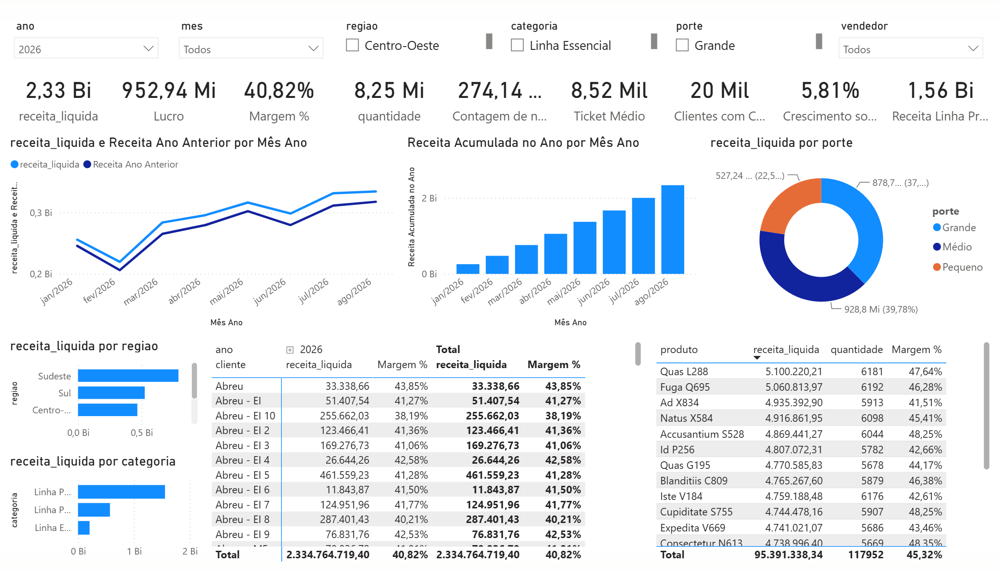
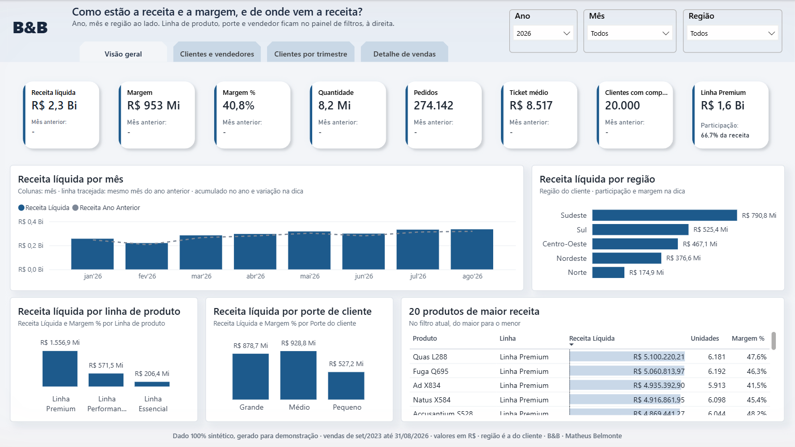

# Refatoração de painéis Power BI

**Mesmos números, modelo 74% menor e consultas até 88% mais rápidas.**

O painel de partida funciona e dá os números certos no uso do dia a dia, mas pesa: arquivo grande,
atualização demorada, página principal lenta, e qualquer ajuste pequeno exige mexer em tudo. Ele foi
montado de propósito, sobre base sintética, com nove defeitos comuns em painel de empresa. A
refatoração reestrutura o painel sem mudar nenhum número de negócio e comprova o ganho medindo antes
e depois do mesmo jeito.

| Antes | Depois |
|---|---|
|  |  |

## Resultado

Demonstração com 5 milhões de linhas de venda, medida na mesma máquina e conferida número a número.

| Tamanho do modelo | Atualização | Consultas da página principal | Números de negócio |
|---|---|---|---|
| **−74%** 515 MB para 135 MB | **−29%** 84 s para 59 s | **−22% a −88%** conforme o filtro | **0 divergências** em 164.831 comparações |

O tamanho do modelo é número firme. Os tempos valem como ordem de grandeza, e o
[guia técnico](evidencias/README.md) traz a medição completa, com faixa de cada execução e os limites
declarados.

## O que você recebe

- **Painel reestruturado**, em formato PBIP, com fatos e cadastros separados, indicadores escritos
  uma vez só e navegação padronizada entre as páginas.
- **Registro de mudanças**, com cada alteração, o motivo e o efeito, em linguagem de negócio.
- **Comprovação de paridade**, com os mesmos 16 indicadores conferidos em nove cortes, antes e depois.
- **Medição de desempenho** antes e depois, com método e máquina declarados.
- **Catálogo de técnicas** aplicadas, para a equipe saber manter o painel depois da entrega.

## Como funciona

1. **Diagnóstico.** Levanta o que pesa, o que quebra e o que dificulta a manutenção no painel atual.
2. **Refatoração.** Corrige um problema por vez, em passos pequenos, sem alterar regra de negócio.
3. **Comprovação.** Mede tamanho, atualização e tempo de consulta, e confere que cada número
   continua igual ao original.

## O que costuma estar errado

Os problemas abaixo aparecem com frequência em painel de empresa, e a demonstração mostra cada um corrigido.

- Tabela única com vendas, produtos, clientes e vendedores repetidos em milhões de linhas.
- Colunas calculadas linha a linha e colunas pesadas que nenhum visual usa.
- Indicadores recalculados de um jeito diferente em cada visual.
- Página principal com dezenas de visuais disparando consultas a cada filtro.
- Contas de ano anterior e acumulado que quebram quando entra uma coluna de data nova.
- Relações nos dois sentidos, listas de filtro que encolhem sem motivo e relação desativada sem dono.

## O que a conferência encontrou

A conferência de paridade encontrou um erro que o painel antigo escondia. Com um vendedor e um mês
escolhidos, o ano anterior mostrava erro de cálculo. No painel reestruturado, o mesmo corte mostra
R$ 269.893,41, valor conferido direto na base. Além de ficar mais leve, o painel passou a calcular
um número que antes não conseguia.

## Depois da entrega

O registro de mudanças e o catálogo de técnicas servem também ao serviço de manutenção. Cada ajuste
num painel em uso vira um passo registrado, com o motivo, o efeito e a conferência de que nenhum
número mudou sem aviso, e o que muda de comportamento fica escrito antes do aceite.

## Contato

Para aplicar a refatoração no seu painel, fale comigo pelo [LinkedIn](https://www.linkedin.com/in/mbelmontee).

## Para aprofundar

| Documento | O que traz |
|---|---|
| [Guia técnico](evidencias/README.md) | medição completa, paridade e como refazer tudo numa máquina limpa |
| [Registro de mudanças](registro-de-mudancas.md) | cada alteração, passo a passo, no formato que acompanha a entrega |
| [Catálogo de técnicas](catalogo-de-tecnicas.md) | o repertório de refatoração e manutenção do serviço |
| [Metodologia](evidencias/metodologia.md) | os defeitos, os indicadores de paridade e os protocolos de medição |
| [Painel antes](painel-antes/README.md) e [painel depois](painel-depois/README.md) | os dois painéis em PBIP, prontos para abrir no Power BI Desktop |

Custo da demonstração: zero, porque o Power BI Desktop e o gerador de dados são gratuitos e nada fica
hospedado. A base é 100% fictícia, gerada pelo
[`port-gerador-dados`](https://github.com/Bellmonte/port-gerador-dados), sem vínculo com organização
ou pessoa real.

---

**B&B** · Matheus Belmonte
