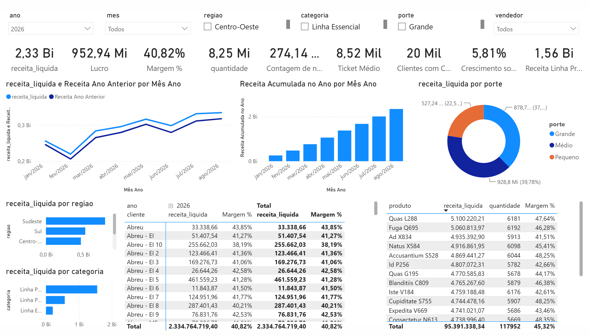
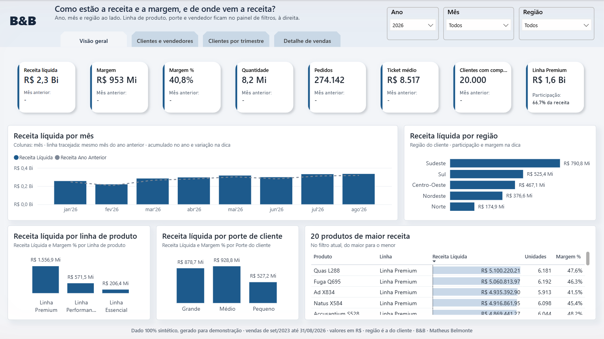
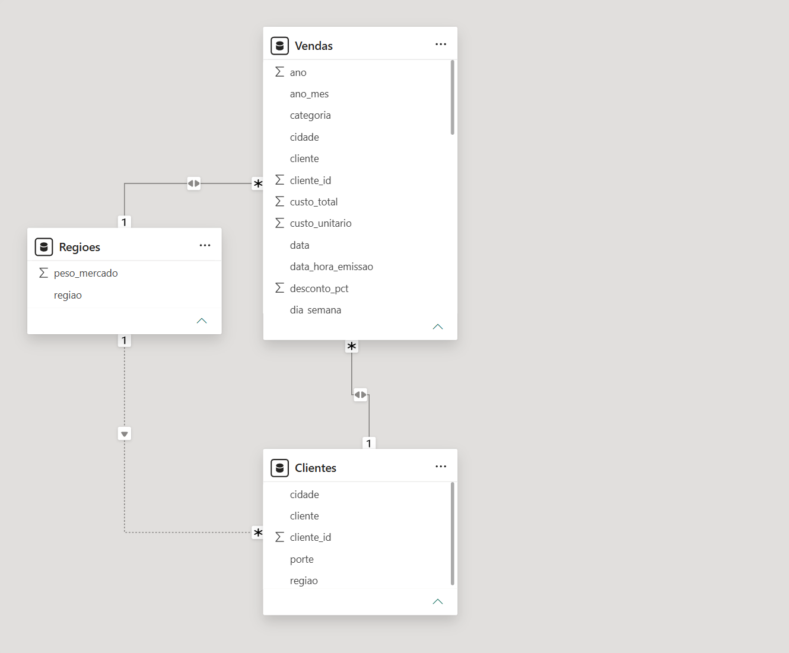
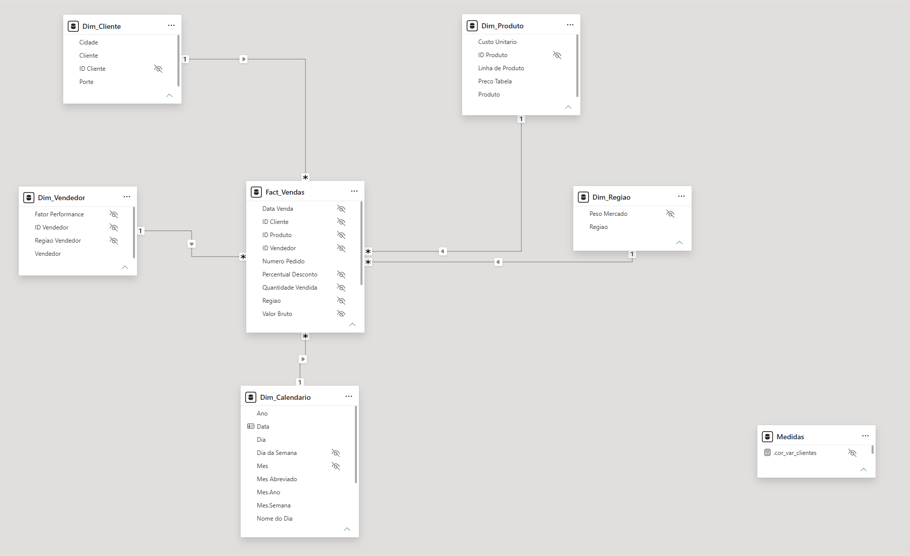
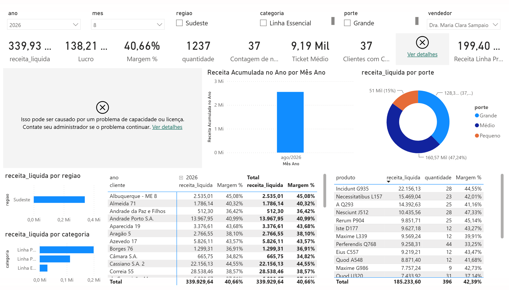
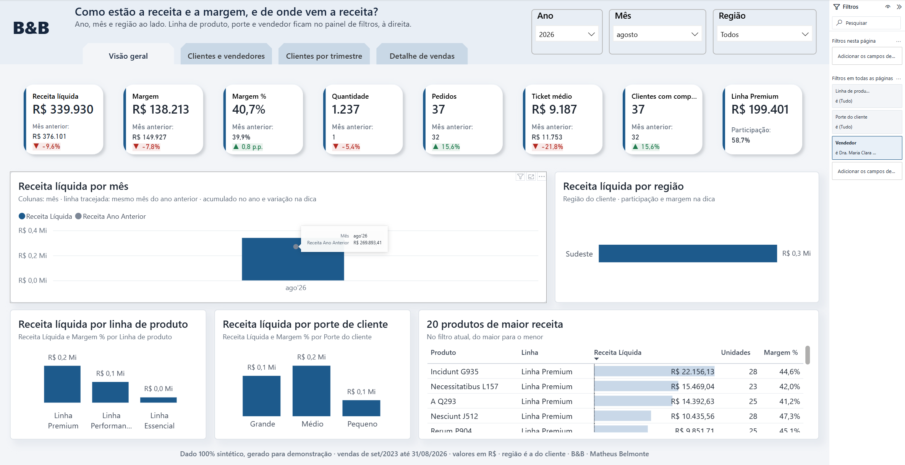
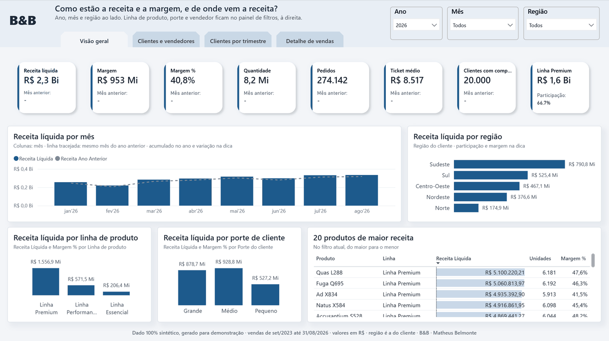

# Guia técnico: refatoração de um painel comercial

Este guia reúne a medição completa, a prova de paridade e o passo a passo para refazer tudo numa
máquina limpa. A [página do serviço](../README.md) traz o resumo para quem decide, e aqui está o
detalhe para quem audita ou quer reproduzir.

Os dois painéis estão em formato PBIP, que é o projeto do Power BI em texto: o
[painel antes (v1)](../painel-antes/README.md), com os defeitos que motivam a
refatoração, e o [painel depois (v2)](../painel-depois/README.md), na forma em que ele
sai do serviço. O [catálogo de técnicas](../catalogo-de-tecnicas.md) é o repertório do serviço.

> **Dados 100% fictícios.** Todos os clientes, vendedores, produtos e valores foram gerados pelo
> [`gerador-de-dados`](https://github.com/Bellmonte/gerador-de-dados), sem qualquer vínculo com
> organização ou pessoa real. O painel antes foi **construído de propósito com defeitos comuns de
> mercado**, os mesmos que aparecem em painel de empresa de verdade.





## O resultado

A medição usou a base de 5 milhões de linhas de venda e a mesma máquina, com cinco execuções por
leitura. O painel de partida (v1) foi medido em 06-10-2026 e o reestruturado (v2), já no padrão de
entrega descrito mais abaixo, em 10-10-2026. Cada célula traz a mediana e, entre parênteses, a faixa
das execuções. Uma diferença só é afirmada quando as faixas da v1 e da v2 não se sobrepõem, e onde
elas se sobrepõem a tabela diz que não houve diferença mensurável.

| O que foi medido | v1, de partida | v2, reestruturado | Variação |
|---|---|---|---|
| tamanho do modelo | 515,2 MB | 134,8 MB | **−74%** |
| tempo de atualização | 84,2 s (82,8 a 85,5) | 59,4 s (58,9 a 62,5) | **−29%** |
| Visão geral na tela, sem filtro | 432 ms (419 a 452) | 335 ms (313 a 372) | **−22%** |
| Visão geral na tela, Sudeste e 2026 | 373 ms (338 a 384) | 389 ms (374 a 408) | sem diferença mensurável |
| consultas da Visão geral, sem filtro, cache limpo | 594 ms (572 a 680) | 145 ms (139 a 150) | **−76%** |
| consultas da Visão geral, sem filtro, cache quente | 236 ms (229 a 238) | 28 ms (28 a 29) | **−88%** |
| consultas da Visão geral, Sudeste e 2026, cache limpo | 207 ms (205 a 217) | 162 ms (159 a 172) | **−22%** |
| consultas da Visão geral, Sudeste e 2026, cache quente | 94 ms (90 a 96) | 58 ms (54 a 79) | **−38%** |

O modelo encolheu a um quarto, e a maior parte do ganho veio do dicionário, que caiu de 246 MB para
15 MB porque as colunas calculadas linha a linha saíram, as colunas pesadas sem uso saíram ou
mudaram de tipo e os atributos dos cadastros deixaram de se repetir em cada linha de venda. A
atualização ficou quase um terço mais rápida. As consultas da Visão geral, que é a página que todo
mundo abre, ficaram de 22% a 88% mais rápidas, porque a página passou de 19 consultas sobre uma
tabela única para 7 consultas sobre cadastros separados e indicadores escritos uma vez só.

Na tela o ganho é menor que nas consultas, e com Sudeste e 2026 escolhidos ele desaparece. A
diferença foi gasta em informação: a v2 ganhou a faixa de indicadores com o valor do mês anterior e
a variação de cada um, além do cabeçalho e do rodapé novos. Na rodada de 06-10-2026, antes dessa
padronização e com as duas pontas na mesma versão do Desktop, a Visão geral da v2 abria cerca de
40% mais rápido nos dois estados de filtro, e esse número continua registrado em
[`desempenho/resultado-final-2026-10-06.md`](desempenho/resultado-final-2026-10-06.md).

"Na tela" é o tempo que o usuário vê, do clique até o último visual desenhado, lido pelo analisador
de desempenho do Desktop. "Consultas" é a soma das consultas que a página dispara, medida por script
direto no motor, com o cache limpo antes de cada execução ou já aquecido. O tamanho é uma leitura
feita depois de uma atualização completa e conferida por uma segunda. A tabela final está em
[`desempenho/resultado-final-2026-10-10.md`](desempenho/resultado-final-2026-10-10.md), cada execução está
em [`desempenho/resultados.csv`](desempenho/resultados.csv), e a máquina está descrita em
[`desempenho/maquina.md`](desempenho/maquina.md).

**Limites da medição.** A v1 foi medida no Power BI Desktop 2.155 e a v2 no 2.158. O protocolo pede
as duas pontas na mesma versão e na mesma sessão, porque o Desktop muda a cada versão. O tamanho do
modelo é lido no motor e quase não depende da versão, e a atualização e as consultas da Visão geral
mostram diferenças bem maiores que a variação entre as sessões de 05-10 e 06-10-2026. Mesmo assim,
os tempos desta tabela valem como ordem de grandeza, e o tamanho como número firme.

O Detalhe de vendas ficou fora da comparação final de propósito. É uma tabela no grão de linha de
venda, a página de exportação que todo painel acaba tendo, e sem filtro ela lê os 5 milhões de
linhas com ou sem refatoração. Na rodada de 06-10-2026, com as duas pontas na mesma versão do
Desktop, ela já não tinha mostrado diferença mensurável na tela (6,7 s na v1 e 6,1 s na v2, com as
faixas se sobrepondo), e com as pontas em versões diferentes a comparação deixaria de se sustentar.
Na v2 essa página ainda faz quatro consultas pequenas a mais, que são as listas das três caixas
sincronizadas e o texto do rodapé. O que mudaria esse tempo é o desenho da página, com paginação ou
filtro obrigatório, e isso altera um comportamento que o usuário já conhece. Como a regra da
refatoração é preservar o comportamento, essa mudança ficou de fora e está registrada aqui como
próximo passo possível.

## O que estava errado e o que foi feito

Os nove problemas abaixo aparecem com frequência em painel de empresa, e quase sempre nascem de boa
intenção: alguém precisou de um número rápido e resolveu do jeito que sabia. Cada um foi corrigido
num passo próprio, na ordem em que um destrava o seguinte, e o
[registro de mudanças](../registro-de-mudancas.md) conta essa sequência no formato que acompanha a entrega do
serviço.

| # | Problema | O que foi feito | Resultado |
|---|---|---|---|
| D1 | vendas, produtos, clientes, vendedores e calendário eram juntados numa tabela só a cada atualização, repetindo cada atributo em todas as linhas | as vendas ficaram só com os fatos e as chaves, e cada cadastro virou uma tabela própria, ligada por relação | o modelo deixou de carregar o mesmo nome de produto milhões de vezes, e incluir um atributo novo ficou simples |
| D2 | o código da linha e a data e hora da emissão eram carregados sem aparecer em nenhum visual, e o número do pedido era guardado como texto | as duas colunas sem uso saíram na leitura, e o pedido passou a ser guardado como número, ainda exibido como `PV-000000123` | saíram ou encolheram colunas que somavam cerca de 30 MB no ensaio inicial, em 1 milhão de linhas |
| D3 | lucro e margem eram calculados linha a linha em cada venda, um deles sem uso, e o rótulo do mês também | a margem virou um indicador calculado na hora sobre a margem que já vem da origem, e o mês foi para o calendário | as duas colunas calculadas ocupavam cerca de um terço do modelo no ensaio inicial e deixaram de existir |
| D4 | cada visual somava a coluna do seu jeito, com formato próprio | cada indicador virou uma medida única, com o nome que o negócio usa, e todos os visuais usam a mesma | o mesmo número aparece com o mesmo formato em todo lugar, e um indicador novo nasce de um lugar só |
| D5 | linha premium, clientes com compra e ticket médio davam o número certo percorrendo a tabela de vendas inteira a cada filtro | as três foram reescritas com filtro direto, contagem distinta e divisão de receita por pedidos | os mesmos números com consultas baratas, que junto com o D6 deixam as consultas da Visão geral de 22% a 88% mais rápidas |
| D6 | a Visão geral tinha 22 visuais e disparava 19 consultas a cada filtro | os indicadores foram para uma faixa num visual só, filtros secundários foram para o painel de filtros e a matriz de clientes por trimestre ganhou página própria, sem nenhum número sair do alcance do usuário | 14 visuais, contando cabeçalho, faixa de indicadores e rodapé, e 7 consultas no lugar de 19 |
| D7 | ano anterior e acumulado no ano eram calculados sobre a data das vendas, com um remendo que listava nove colunas de data, e qualquer coluna nova quebraria as contas sem aviso | o calendário passou a ser a tabela de data oficial do modelo, e o remendo saiu | as contas de tempo ficaram à prova de coluna nova, e um erro que a v1 escondia apareceu e foi corrigido (veja abaixo) |
| D8 | regiões e clientes filtravam as vendas nos dois sentidos, as listas de filtro encolhiam sem motivo e havia uma relação desativada que ninguém sabia explicar | toda relação passou a ir do cadastro para as vendas, num sentido só, e a região ficou num lugar só | listas de filtro estáveis, sem relação desativada, e nenhum indicador mudou |
| D9 | a tabela de clientes era montada a partir das vendas, e a atualização relia os 5 milhões de linhas e refazia todas as junções só para tirar a lista de clientes | a tabela de clientes passou a ler o cadastro direto | a atualização deixou de fazer o trabalho pesado duas vezes |





A [metodologia](metodologia.md) traz cada problema com o motivo de existir, o efeito esperado em
cada medição e o protocolo completo de medição e de paridade.

## Os números de negócio não mudaram

A regra do serviço é que quem usa o painel continue vendo os mesmos números depois da refatoração. Para
provar isso, 16 indicadores foram conferidos em nove cortes (total, mês, região, linha de produto,
porte, vendedor, cliente, mês por região e um estado com filtro), em três pontas: a conta feita
direto nos arquivos da base, sem passar pelo Power BI, e os dois painéis, o de partida e o
reestruturado. Contagem
precisa ser igual, valor em reais pode diferir até um centavo e percentual até a sexta casa decimal,
só para absorver a ordem de soma em ponto flutuante.

| Rodada | Base | Pontas | Comparações | Divergências |
|---|---|---|---|---|
| depois da refatoração | 1 milhão | base, v1 e v2 | 494.493 | **0** |
| depois do redesenho visual da v2 | 1 milhão | base e v2 | 164.831 | **0** |
| depois da padronização da v2, em 10-10-2026 | 5 milhões | base e v2 | 164.831 | **0** |

A base de 1 milhão sai do mesmo comando do gerador com menos linhas, e a de 5 milhões é a mesma da
medição. A v1 não mudou desde a primeira rodada, e por isso as rodadas seguintes conferem só a v2
contra a conta feita na base. Os resultados estão em [`paridade/`](paridade/README.md).

Duas mudanças de comportamento ficam declaradas antes do aceite. A primeira é que as listas de
filtro passaram a mostrar o cadastro inteiro, em vez de encolher conforme os outros filtros. A
segunda é o achado da conferência, descrito a seguir.

### O achado: o ano anterior quebrava em corte fino

Fora dos cortes acordados, a conferência encontrou um erro que ninguém plantou. As contas de ano
anterior da v1 trabalhavam sobre a data das vendas, e quando o filtro é fino o bastante para deixar
dias sem venda no período, como um vendedor num mês, o Power BI recusa o cálculo. Na base de 1
milhão, um vendedor que vendeu em 23 dos 31 dias de agosto de 2026 faz o visual de ano anterior da v1
mostrar erro assim que ele e o mês são escolhidos na Visão geral. Na v2, com o calendário oficial, o
mesmo corte mostra R$ 269.893,41, que é a receita desse vendedor em agosto de 2025 inteiro, conferida
direto na base. Além de deixar o painel mais leve, a refatoração consertou um número que a v1 não
conseguia mostrar.





## O painel reestruturado

A v2 tem quatro páginas com o mesmo chassi: o cabeçalho com o logotipo B&B, a pergunta de negócio
que a página responde, as abas de navegação e as caixas de ano, mês e região sincronizadas entre as
páginas, e o rodapé com a janela da base, a unidade e o aviso de dado sintético. Linha de produto,
porte e vendedor ficam no painel de filtros, valendo para o relatório inteiro, e o clique com o botão
direito num cliente, produto ou vendedor leva direto aos itens de venda dele. Na Visão geral, a
faixa de indicadores mostra, com um único mês escolhido, o valor do mês anterior e a variação de
cada indicador numa pílula verde ou vermelha. O sistema visual e o layout de cada página estão em
[`painel-depois/design/`](../painel-depois/design/).

### O padrão de entrega

Depois de corrigida, a v2 foi reconstruída no padrão de desenvolvimento que acompanha todo painel
entregue pelo serviço, para que quem mantém o painel depois encontre cada coisa onde espera. As
tabelas dizem no nome o papel que têm: as vendas ficam em `Fact_Vendas`, no centro, e os cadastros
em `Dim_Produto`, `Dim_Cliente`, `Dim_Vendedor`, `Dim_Regiao` e `Dim_Calendario`, em volta. Todo
indicador mora numa tabela própria, `Medidas`, com o nome que o negócio usa, a unidade e uma
descrição do que ele é e de quando usar. O calendário é gerado por uma função a partir da janela da
base, e o ano anterior é calculado deslocando o calendário em um ano, com `DATEADD`. Na tela, a
padronização trouxe a faixa de indicadores com o mês anterior e a pílula de variação. Nenhum número
de negócio mudou com isso, e a terceira rodada de paridade, já em 5 milhões de linhas, confere essa
afirmação. A seção de padronização do [registro de mudanças](../registro-de-mudancas.md) traz cada mudança.



## Como subir na sua máquina

Pré-requisitos: Windows com o Power BI Desktop 2.158 ou mais novo, que é a versão em que a v2 foi
salva, Python 3.12 ou mais novo e Git. A base de 5 milhões ocupa cerca de 530 MB em disco e foi
medida numa máquina com 16 GB de memória; com menos memória, a base de 1 milhão serve para a mesma
demonstração, com folga.

**1. Gerar a base.** O painel não leva dado nenhum, só a definição do modelo e das páginas, e por
isso o primeiro passo é gerar a base com o `gerador-de-dados`. No PowerShell:

```powershell
git clone https://github.com/Bellmonte/gerador-de-dados.git
cd gerador-de-dados
python -m venv .venv
.venv\Scripts\pip install -r requirements.txt
```

Para explorar o painel, a base de 1 milhão de linhas sai em poucos segundos:

```powershell
.venv\Scripts\python gerar.py comercial --hoje 2026-08-31 --meses 36 --linhas 1000000 --clientes 20000 --produtos 1500 --vendedores 150 --colunas-origem --saida C:\dados\painel-comercial
```

Para reproduzir a medição, use a base de 5 milhões, que sai do mesmo comando com mais linhas em
cerca de 35 segundos:

```powershell
.venv\Scripts\python gerar.py comercial --hoje 2026-08-31 --meses 36 --linhas 5000000 --clientes 20000 --produtos 1500 --vendedores 150 --colunas-origem --saida C:\dados\painel-comercial
```

Os arquivos saem em `C:\dados\painel-comercial\comercial\`, junto de um `_manifesto.json` com a contagem de
linhas e as somas de controle. A data `--hoje 2026-08-31` precisa ficar fixa, porque é ela que faz a
base sair igual em qualquer máquina e em qualquer dia, com os mesmos números deste README. Os dois
comandos gravam na mesma pasta, e rodar um depois do outro troca a base.

**2. Abrir e apontar para a base.** Clone este repositório
(`git clone https://github.com/Bellmonte/servicos-power-bi.git`) e abra
`refatoracao-de-paineis/painel-antes/painel-antes.pbip` no Power BI Desktop. O parâmetro
`PastaDados` já vem com `C:\dados\painel-comercial\comercial\`, e quem gerou a base nessa pasta pula para o
passo 3. Para usar outra pasta, vá em **Página Inicial > Transformar dados > Editar parâmetros** e
cole o caminho da pasta `comercial`, **terminando com barra invertida**.

**3. Atualizar.** Clique em **Atualizar**. O arquivo abre vazio, porque não traz dado salvo, e
enche depois da atualização. Na máquina de medição, a v1 leva cerca de 20 segundos em 1 milhão de
linhas e cerca de 85 segundos em 5 milhões.

**4. Repetir com a v2.** Abra `refatoracao-de-paineis/painel-depois/painel-depois.pbip` e siga os mesmos
passos. Na v2 o parâmetro se chama `pPastaDados`, e o `_manifesto.json` que o gerador grava precisa
ficar na mesma pasta dos CSV, porque o calendário tira dele a janela da base. Os dois arquivos podem
ficar abertos ao mesmo tempo, o que ajuda a comparar página com página.

A data e hora automáticas do Power BI ficam desligadas nas duas versões, e nenhuma conta depende
delas.

## Como conferir a paridade

Os scripts de [`paridade/`](paridade/README.md) consultam os dois painéis abertos no Desktop e
comparam com a conta feita direto na base. Eles precisam da porta local de cada arquivo aberto, que
o PowerShell lista assim, uma linha por arquivo, na ordem em que foram abertos (o DAX Studio também
mostra a porta ao conectar):

```powershell
Get-ChildItem "$env:LOCALAPPDATA\Microsoft\Power BI Desktop\AnalysisServicesWorkspaces" -Recurse -Filter msmdsrv.port.txt | Sort-Object LastWriteTime | ForEach-Object { Get-Content $_.FullName -Encoding Unicode }
```

Com a v1 e a v2 abertas e atualizadas sobre a mesma base, dentro da pasta `evidencias/paridade`:

```powershell
<pasta-do-gerador>\.venv\Scripts\python fonte.py C:\dados\painel-comercial\comercial C:\dados\paridade\fonte
powershell -ExecutionPolicy Bypass -File .\rodar.ps1 -Porta <porta-da-v1> -Arquivo consultas_v1.dax -Saida C:\dados\paridade\v1
powershell -ExecutionPolicy Bypass -File .\rodar.ps1 -Porta <porta-da-v2> -Arquivo consultas_v2.dax -Saida C:\dados\paridade\v2
python comparar.py C:\dados\paridade\resultado.csv fonte=C:\dados\paridade\fonte v1=C:\dados\paridade\v1 v2=C:\dados\paridade\v2
```

O `fonte.py` usa o pandas, por isso roda com o Python do ambiente criado no passo 1, e
`<pasta-do-gerador>` é onde o `gerador-de-dados` foi clonado. O `comparar.py` só usa a
biblioteca padrão, imprime as comparações e as divergências por corte e termina com erro se houver
qualquer divergência.

## Como refazer a medição

Os scripts de [`desempenho/`](desempenho/) falam direto com o motor do Desktop, pela biblioteca de cliente
que vem instalada com ele, e usam a mesma porta do passo anterior. Cada ponta é medida com a base de
5 milhões e só o Desktop aberto, e cada `.ps1` roda com `powershell -ExecutionPolicy Bypass -File`,
como na paridade.

| O que mede | Como |
|---|---|
| tamanho do modelo | `medir_tamanho.ps1 -Porta <porta> -Ponta v1 -Sessao <nome>`, depois de uma atualização completa, e de novo depois de uma segunda |
| tempo de atualização | `medir_atualizacao.ps1 -Porta <porta> -Runs 6 -Ponta v1 -Sessao <nome> -Saida resultados.csv`, com a primeira execução descartada como aquecimento |
| tempo de tela | no Desktop, **Exibir > Analisador de desempenho**, iniciar a gravação, **Atualizar visuais** cinco vezes na página e exportar o JSON; `python tempo_pagina.py <arquivo.json>` calcula o tempo de cada execução |
| tempo das consultas | `python extrai_consultas.py <arquivo.json> vg consultas\v1-visao-geral.dax` tira do JSON as consultas da página (`vg` para a Visão geral, `dv` para o Detalhe de vendas), e `medir_consultas.ps1 -Porta <porta> -Arquivo consultas\v1-visao-geral.dax -Saida consultas.csv -Ponta v1` mede cada uma a frio e a quente |

O protocolo pede a v1 e a v2 medidas na mesma máquina, na mesma versão do Desktop e no mesmo dia,
com o painel de filtros do Detalhe de vendas sem detalhamento aplicado. A rodada final desta
demonstração manteve a mesma máquina e a mesma base, e o desvio de versão está declarado no resultado.
Numa máquina diferente os milissegundos mudam, e o que deve se repetir é a direção da diferença e o critério das faixas. Os
scripts procuram a biblioteca do Desktop em `C:\Program Files\Microsoft Power BI Desktop\bin\`, que
é onde o instalador da Microsoft coloca; quem usa a versão da Microsoft Store troca o caminho na
linha `Add-Type` de cada script, e a lista de portas fica em
`$env:USERPROFILE\Microsoft\Power BI Desktop Store App\AnalysisServicesWorkspaces`.

## O que tem aqui

| Caminho | O que é |
|---|---|
| [`painel-antes/`](../painel-antes/README.md) | o painel de partida, com os nove defeitos |
| [`painel-depois/`](../painel-depois/README.md) | o painel reestruturado, com o sistema visual em `design/` |
| [`registro-de-mudancas.md`](../registro-de-mudancas.md) | o registro de mudanças, passo a passo, no formato que acompanha a entrega do serviço |
| [`catalogo-de-tecnicas.md`](../catalogo-de-tecnicas.md) | o repertório do serviço: o catálogo de técnicas de refatoração e manutenção de painel |
| [`metodologia.md`](metodologia.md) | os defeitos, os indicadores de paridade e os protocolos de medição e de paridade |
| [`paridade/`](paridade/README.md) | consultas, comparador e resultados da paridade |
| [`desempenho/`](desempenho/) | scripts, máquina, ensaio inicial, a rodada de 06-10-2026 e o resultado final de 10-10-2026 |

## Custo

Zero. O Power BI Desktop e o gerador são gratuitos, os scripts usam a biblioteca que já vem com o
Desktop e com o Python, e nada fica hospedado.

## Licença

MIT. O dado é fictício e serve de exemplo.

---

<sub>**B&B** · Matheus Belmonte</sub>
